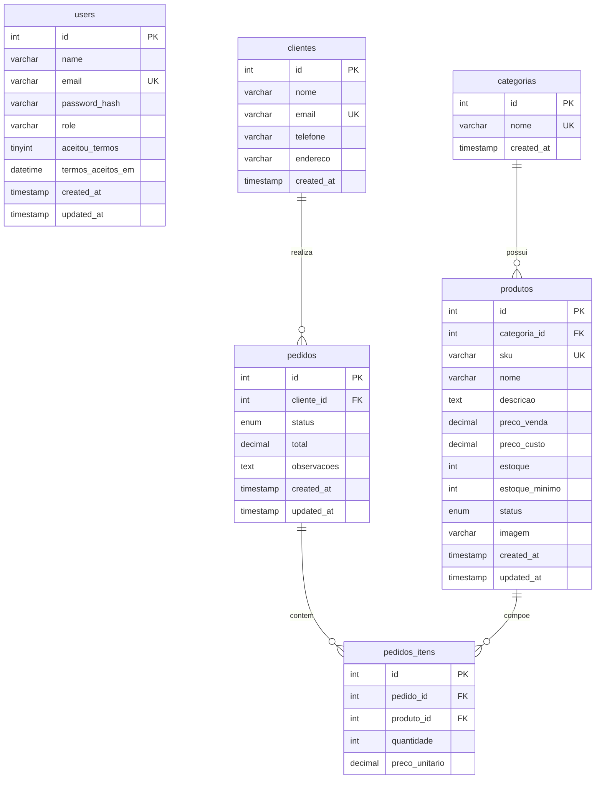

# Diagrama ER — Banco de Dados Kombi Coffee

> Modelo lógico do banco `kombi_coffee` (MySQL / MariaDB / phpMyAdmin).
> Script de criação e dados iniciais: [`database/database.sql`](../database/database.sql).

## Diagrama Entidade-Relacionamento

## Relacionamentos

| Relação | Cardinalidade | Chave estrangeira | Regra |
|---|---|---|---|
| `categorias` → `produtos` | 1:N | `produtos.categoria_id` | Excluir categoria só se não houver produtos (`RESTRICT`) |
| `clientes` → `pedidos` | 1:N | `pedidos.cliente_id` | Excluir cliente só se não houver pedidos (`RESTRICT`) |
| `pedidos` → `pedidos_itens` | 1:N | `pedidos_itens.pedido_id` | Excluir pedido remove os itens (`CASCADE`) |
| `produtos` → `pedidos_itens` | 1:N | `pedidos_itens.produto_id` | Excluir produto só se não estiver em pedidos (`RESTRICT`) |

> A tabela `users` é independente: guarda as contas de acesso ao painel
> (administradores e funcionários) e não possui chave estrangeira.

## Dicionário de dados (resumo)

### `users` — contas de acesso
| Campo | Tipo | Regra |
|---|---|---|
| `id` | INT UNSIGNED | PK, auto incremento |
| `name` | VARCHAR(120) | obrigatório |
| `email` | VARCHAR(180) | obrigatório, único |
| `password_hash` | VARCHAR(255) | hash gerado por `password_hash()` |
| `role` | VARCHAR(50) | `admin` ou `funcionario` |
| `aceitou_termos` | TINYINT(1) | aceite do termo de uso |
| `termos_aceitos_em` | DATETIME | data/hora do aceite |

### `categorias`
| Campo | Tipo | Regra |
|---|---|---|
| `id` | INT UNSIGNED | PK |
| `nome` | VARCHAR(60) | obrigatório, único |

### `produtos`
| Campo | Tipo | Regra |
|---|---|---|
| `id` | INT UNSIGNED | PK |
| `categoria_id` | INT UNSIGNED | FK → `categorias.id` |
| `sku` | VARCHAR(50) | obrigatório, único |
| `nome` | VARCHAR(120) | obrigatório |
| `descricao` | TEXT | opcional |
| `preco_venda` | DECIMAL(10,2) | obrigatório |
| `preco_custo` | DECIMAL(10,2) | padrão `0` |
| `estoque` | INT UNSIGNED | padrão `0` |
| `estoque_minimo` | INT UNSIGNED | padrão `5` |
| `status` | ENUM | `disponivel`, `indisponivel`, `esgotado` |
| `imagem` | VARCHAR(255) | caminho/URL da imagem |

### `clientes`
| Campo | Tipo | Regra |
|---|---|---|
| `id` | INT UNSIGNED | PK |
| `nome` | VARCHAR(120) | obrigatório |
| `email` | VARCHAR(180) | único |
| `telefone` | VARCHAR(20) | opcional |
| `endereco` | VARCHAR(255) | opcional |

### `pedidos`
| Campo | Tipo | Regra |
|---|---|---|
| `id` | INT UNSIGNED | PK |
| `cliente_id` | INT UNSIGNED | FK → `clientes.id` |
| `status` | ENUM | `recebido`, `em_preparo`, `pronto`, `entregue`, `cancelado` |
| `total` | DECIMAL(10,2) | padrão `0` |
| `observacoes` | TEXT | opcional |

### `pedidos_itens`
| Campo | Tipo | Regra |
|---|---|---|
| `id` | INT UNSIGNED | PK |
| `pedido_id` | INT UNSIGNED | FK → `pedidos.id` |
| `produto_id` | INT UNSIGNED | FK → `produtos.id` |
| `quantidade` | INT UNSIGNED | padrão `1` |
| `preco_unitario` | DECIMAL(10,2) | preço no momento da venda |
